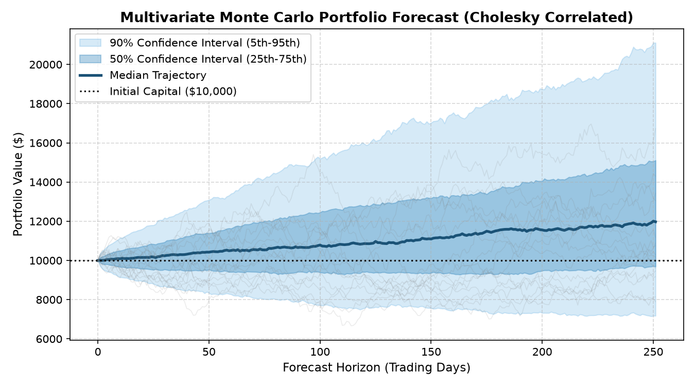
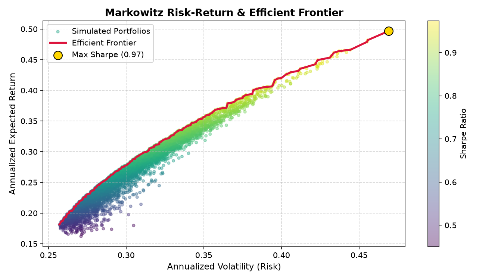

# Quant Risk Engine

[](https://github.com/Priyansh956/Risk-engine-/actions/workflows/ci.yml)
[](LICENSE)
[](https://www.python.org/downloads/)
[](https://github.com/astral-sh/ruff)

A quantitative portfolio risk, optimization, and analytics engine in Python.

Give it your stock tickers and capital weights, and it returns annualized return, volatility, Sharpe ratio, CAPM beta, Value at Risk (VaR), Conditional VaR (Expected Shortfall), and a correlated multivariate Monte Carlo forecast.

---

## 🚀 Live Interactive App

Try the engine directly in your browser without installing:

👉 **[Launch Streamlit Web App]([https://pkds-risk-engine.streamlit.app]))** *(or run locally via `streamlit run app.py`)*

| Monte Carlo Fan Chart (Correlated GBM) | Markowitz Efficient Frontier |
|:---:|:---:|
|  |  |

---

## Features

- **Single `analyze_portfolio()` Entry Point**:
  - Validates weights (must sum to 1.0, non-negative), unique tickers, ticker existence, and sufficient history ($\ge 252$ trading days).
  - Returns expected return, volatility, Sharpe ratio, portfolio beta, CAPM expected return, VaR/CVaR suite, and Monte Carlo scenario summaries in one unified, JSON-serializable object.
- **Correlated Monte Carlo Simulation (`risk_engine.monte_carlo`)**:
  - **Cholesky Decomposition**: Uses the Cholesky factor of the covariance matrix ($\mathbf{\Sigma} = L L^T$) to simulate correlated shocks across assets rather than independent shocks.
  - **Capital-Weighted Portfolio Paths**: Normalizes asset paths by initial prices $S_0$ so weights model capital allocation rather than raw share counts.
  - **Scenario Analysis**: Partitions simulated paths into **Bull Market** (top 10%), **Base Case** (middle 80%), and **Bear Market** (bottom 10%) with scenario terminal values.
- **Value at Risk & Expected Shortfall (`risk_engine.var`)**:
  - Historical VaR & CVaR (95% and 99%).
  - Parametric Gaussian VaR & CVaR.
  - Cornish-Fisher Modified VaR (accounting for skewness and excess kurtosis).
  - Out-of-sample rolling VaR backtesting with Kupiec POF Likelihood Ratio test.
- **Capital Asset Pricing Model (`risk_engine.capm`)**:
  - Covariance beta, excess returns, and OLS regression ($\alpha, \beta, R^2, \text{residuals}$).
  - Beta and Return comparison tables.
- **Markowitz Modern Portfolio Theory (`risk_engine.markowitz`)**:
  - Random long-only portfolio simulation (Maximum Sharpe & Minimum Variance).
  - Exact Pareto-optimal Efficient Frontier extraction.
- **Data Loading (`risk_engine.data_loader`)**:
  - Historical prices, market benchmarks (`^GSPC`), and risk-free rates (`^TNX`) via Yahoo Finance.


## Installation

```bash
git clone https://github.com/Priyansh956/Risk-engine-.git
cd Risk-engine-

python -m venv venv
source venv/bin/activate  # On Windows: venv\Scripts\activate

pip install -e .
pip install -r requirements-dev.txt  # only needed for running tests and linting
```

---

## Quickstart

### 1. Unified Analysis (`analyze_portfolio`)

```python
from risk_engine import analyze_portfolio

# Analyze a portfolio (e.g. 50% AAPL, 30% MSFT, 20% NVDA)
result = analyze_portfolio(
    tickers=["AAPL", "MSFT", "NVDA"],
    weights=[0.5, 0.3, 0.2],
    start_date="2021-01-01",
    min_history=252,  # Requires at least 1 trading year
    mc_time_horizon=252,  # 1-year forward forecast
    mc_simulations=1000,  # 1,000 simulation paths
    random_state=42,
)

print(f"Annual Expected Return: {result.portfolio_return:.2%}")
print(f"Annual Volatility:      {result.portfolio_volatility:.2%}")
print(f"Sharpe Ratio:           {result.sharpe_ratio:.2f}")
print(f"Portfolio Beta:         {result.portfolio_beta:.2f}")
print(f"CAPM Expected Return:   {result.capm_expected_return:.2%}")

# Value at Risk & Expected Shortfall
print(f"95% Historical VaR:     {result.var_metrics['historical_var_95']:.2%}")
print(f"95% Historical CVaR:    {result.var_metrics['historical_cvar_95']:.2%}")

# Monte Carlo Terminal Summary
mc = result.monte_carlo_summary
print(f"MC Median Outcome:      ${mc['terminal_median']:.2f}")
print(f"MC Worst Case (5th %):  ${mc['terminal_5th_percentile']:.2f}")
print(f"MC Best Case (95th %):  ${mc['terminal_95th_percentile']:.2f}")

# JSON-ready dictionary output (safe for APIs & web applications)
data_dict = result.to_dict(include_paths=False)
```

### 2. Empirical VaR Backtesting

```python
from risk_engine import backtest_var, calculate_log_returns, fetch_stock_data

# Backtest whether 95% Parametric VaR underestimates real market losses
prices = fetch_stock_data(["AAPL", "MSFT"], start="2020-01-01", end="2024-01-01")
returns = calculate_log_returns(prices).dropna()
port_returns = returns["AAPL"] * 0.6 + returns["MSFT"] * 0.4

bt_hist = backtest_var(port_returns, window=252, confidence=0.95, method="historical")
bt_param = backtest_var(port_returns, window=252, confidence=0.95, method="parametric")

print(f"Historical VaR Breach Rate: {bt_hist['breach_rate']:.2%}")  # ~5.4% (near 5% expected)
print(f"Parametric VaR Breach Rate: {bt_param['breach_rate']:.2%}")  # ~6.6% (fat tails understate risk)
```

---

## Return Conventions

All returns throughout the engine are standardized on the **compounded effective annual return convention**:

$$R_{\text{annual}} = \exp(\bar{r}_{\text{daily, log}} \times \text{trading\_days}) - 1$$

- **Stock / Portfolio Return**: Compounded annualized return from daily log returns.
- **Market Return**: Compounded annualized return from benchmark log returns.
- **Risk-Free Rate**: Effective annual yield $R_f$ (e.g., 0.04 for 4.0%).
- **Daily Risk-Free Rate**: $(1 + R_f)^{1/252} - 1$.
- **Market Risk Premium**: $R_m - R_f$.
- **CAPM Expected Return**: $R_f + \beta (R_m - R_f)$.

---

## Project layout

```
├── app.py                             # Interactive Streamlit Web App
├── pyproject.toml                     # Package metadata, dependencies, & tool configs
├── requirements.txt                   # Production dependencies
├── requirements-dev.txt               # Testing & linting tools
├── src/
│   └── risk_engine/                   # Primary Python package
│       ├── __init__.py                # Package-level exports
│       ├── returns.py                 # Return calculations
│       ├── risk.py                    # Volatility, covariance, & correlation metrics
│       ├── markowitz.py               # Modern Portfolio Theory & Efficient Frontier
│       ├── capm.py                    # CAPM regression & beta analysis
│       ├── monte_carlo.py             # Correlated GBM simulation & scenario filtering
│       ├── var.py                     # VaR, CVaR, & rolling backtesting
│       ├── data_loader.py             # Historical data loading (yfinance)
│       └── portfolio.py               # analyze_portfolio orchestrator & PortfolioAnalysisResult
├── tests/                             # Comprehensive 54-test pytest suite
└── notebooks/
    └── main.ipynb                     # Step-by-step exploratory research walkthrough
```

## Development

```bash
pytest             # Run the full test suite (54 tests passed)
ruff check .       # Fast linting
ruff format .      # Fast code formatting
streamlit run app.py  # Run interactive web application
```

CI runs the same lint, format check, and tests on every push and pull request.

---

## Known Limitations & Findings

- **Fat Tails in Returns**: Geometric Brownian Motion assumes returns follow a log-normal distribution. In our 500-day rolling backtest on real equities, 95% Parametric Gaussian VaR experienced a 6.6% breach rate (understating risk by ~32%), demonstrating why Historical and Cornish-Fisher Modified VaR are critical for real-world risk management.
- **Markowitz Random Sampling**: `simulate_random_portfolios` approximates the efficient frontier by random uniform sampling. Exact quadratic programming with constraints (`scipy.optimize`) is on the roadmap.
- **Data Source**: Data is fetched via Yahoo Finance (`yfinance`). Ensure valid ticker symbols and sufficient trading history ($\ge 252$ trading days) for robust estimation.

---

## Roadmap

- [x] Fix Monte Carlo capital weighting and Cholesky correlation
- [x] Single `analyze_portfolio()` entry point with complete validation
- [x] Robust error handling for invalid tickers, duplicate tickers, weights, and missing data
- [x] Value at Risk (historical, parametric, modified), Conditional VaR, and backtesting
- [x] Interactive web application (`app.py`) for Streamlit deployment
- [x] MIT License and visual assets in documentation
- [ ] Exact constrained optimization (min-variance, max-Sharpe) with `scipy.optimize`
- [ ] Support for Indian markets (NSE tickers, Nifty 50 benchmark, Indian risk-free rate)
- [ ] Publish to PyPI under `quant-risk-engine`

---

## Disclaimer

This project is for educational and informational purposes only and is not financial advice. Results are based on historical data, which does not predict future performance. Do not make investment decisions based solely on this tool.

---

## Contributing

Contributions and bug reports are welcome. Before submitting a pull request, ensure `pytest`, `ruff check .`, and `ruff format --check .` all pass.

---

## License

Released under the [MIT License](LICENSE).

